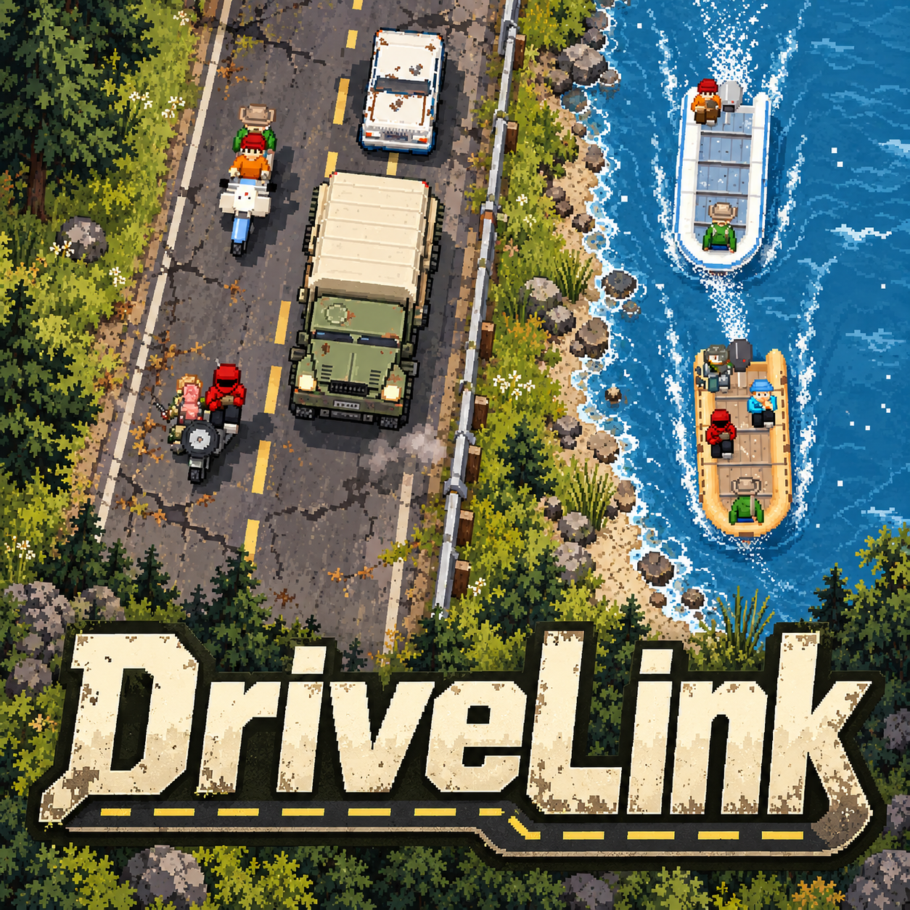

# DriveLink

Walk, drive, ride or sail from one DayZ server to another - with your character, everything you carry, your car
and your crew. DriveLink links DayZ servers (and maps) into one world: players leave through a zone at the edge of
a map and arrive on the next server. The road between costs food, water and fuel, takes time if you want it to,
and can cost more than that.

**Status: public test.** Back up your servers before trying it.

Current source baseline: mod **0.5**, Hub **0.5.0**, Windows companion **0.4.8-rc3**. Both the game mod and
Hub are maintained in this repository. Windows helper/agent/setup/updater source and build instructions are
in [Companion](Companion/README.md); its release addon is [Addons/DriveLinkRestart](Addons/DriveLinkRestart).

## How it fits together

| Part | Where it runs | What it does |
|---|---|---|
| **@DriveLink** (mod) | every DayZ server in the network, and every player's game (Workshop) | Leaving zones, packing a character (gear, health, stomach, car) for the trip, building it on arrival, the road film on the arrival screen |
| **DriveLink Hub** | one PC that every DayZ server can reach (one of the server machines is fine) | Holds characters while they travel, so a character is only ever on one server; the web app where you set everything up |

DayZ 1.30. No other mods are needed.

## Install

### 1. The hub

Download a Windows package from [GitHub Releases](https://github.com/d3rk99/DriveLink/releases/latest).
Choose **with-official-maps** for ready-built Chernarus, Livonia, Sakhal and Nasdara backgrounds, or the smaller
Hub-only ZIP if you already have map images. Keep the bundled `maps` folder next to `DriveLinkHub.exe`.
The bundled backgrounds do not require DayZ Tools; additional maps can be built from local game files with
DayZ Tools or imported from a complete map image. DLC map folders are detected automatically.

1. Unzip **DriveLinkHub** into its own folder and start `DriveLinkHub.exe`. The first start writes `hub.json`
   (with a random server key) and prints a web app password.
2. Open **http://localhost:7290/admin** on that PC (from another PC: `http://<hub-ip>:7290/admin` + the password).
3. **Setup** page: copy the two lines for the DayZ servers (`hubUrl`, `hubKey`), set the hub's public address if
   servers reach it over the internet, and apply the firewall rules (Windows asks for administrator rights once).
4. To keep it running without a console: `DriveLinkHub.exe install` in an administrator terminal (Windows service;
   `uninstall` removes it).

Ports: **7290** (HTTP) and **7291** (HTTPS, self-signed unless you set `tlsCert` / `tlsKey` in hub.json).

### 2. Each DayZ server

1. Add `@DriveLink` to the server's `-mod=` list and copy the supplied public `.bikey` files from `@DriveLink\keys` into the server's
   `keys` folder.
2. Start the server once: it writes `<profiles>\DriveLink\config.json`. Put in the two lines from the hub's Setup
   page and restart.
3. On the hub's **Servers** page the server shows up under "Asking to join": approve it (name, address, port).
4. On the **Map** page, pick the server and draw:
   - **Leaving zones**: where players leave, which server they go to, which arrival point there, and the trip's
     distance in km (0 = free and instant). Zones can be circles or squares / strips (a whole map border).
   - **Arrival points**: where players come out, facing which way. A car that comes along stands at its car spot
     (convoys line up behind it); a boat goes on the nearest free water, or a boat spot you pin.
   - **Travelled cars** (servers with `carEconomy` "track" or "veto"): every car that has travelled, where its server
     last reported it (every minute). Blue = this server's own, yellow = visiting. Click one for its home server,
     health, fuel and its last 10 trips.

Players subscribe to [DriveLink on Workshop](https://steamcommunity.com/sharedfiles/filedetails/?id=3824238331)
and load the server's required mods. Matching-mod routes do not need the Windows helper. Routes that switch
client mod lists require its disclosed, one-time setup from `@DriveLink\Helper\DriveLink Setup.exe` and
already-downloaded destination mods. The setup installs the background tray agent for future sessions;
players can remove it through its tray menu or Windows installed apps.

### Automatic client switching (Hub and mod 0.4.9-rc1 or newer)

Leave **Client switching** on **Automatic** in the Hub's server editor. The Hub queries each server's UDP
Steam query port and compares its advertised client mod identities, order and builds. Identical lists use
direct reconnect; different lists use the helper. Official map/DLC flags and server-only mods do not count
as client mod differences. The query port must be reachable from the Hub.

No manual `routes.json` editing is needed. The server receives the policy with normal Hub polling and writes
`<profiles>\DriveLinkRestart\hub-routes.json` as a generated diagnostic cache. Missing or stale query data
pauses departure with an explanation, rather than claiming the player needs helper setup. Conflicting builds
of a shared mod require server mod versions to be synchronized.

An administrator can choose **Keep client** or **Restart** for an individual destination in the Hub. Overrides
are directional and bypass the automatic comparison; return to Automatic to remove one. Explicit legacy
`routes.json` entries are a fallback for an older Hub, not the configuration method for an updated network.

### Optional arrival staging

In the Map editor, an arrival can have a separate staging position and direction for land vehicles and boats.
Choose an empty area with suitable terrain or water and enough space for the convoy. The mod prepares the
crew and vehicles there, then moves the ready arrival to its configured destination. Existing arrival points
keep staging disabled unless the owner enables it. Staging needs a supporting DriveLink mod on the servers
and clients; the Hub alone cannot change vehicle behavior.

## Settings

### Travel (hub, Servers page -> a server -> Travel)

Rules for trips that **start** on that server, per 10 km of the zone's distance. Pick a preset or set your own:

| Preset | In short |
|---|---|
| **Easy** | Free and instant: no food, water, fuel, wear, time or risk |
| **Medium** | A small bill, pay or don't go, no deaths, no waiting |
| **Hard** | DayZ's own rates (the game's fuel use, food/water as if you jogged), travel time, the road can hurt or kill |
| **Realism** | Real-world numbers (Research/travel-presets.md), walking pace, real road risks |

- **When a player is short**: refuse the trip, or let them go and the road decides (they may arrive weakened, lose
  the car, or die on the way).
- Food in kcal, water in ml (a full DayZ bar is 5000 of each; a can of beans is 800 kcal, a water bottle 1 L).
- Fuel: flat litres per 10 km, or each vehicle's own in-game consumption.
- On the road (arrive-weakened mode) players may find gas stations, food and water; closed cans count when someone
  can open them.
- Groups on foot and convoys of cars / boats travel together when they enter a zone together.
- The road film (on the arrival screen) can be switched off, and skipping can need everyone's vote.

### Starting server (hub, Servers page)

Whoever dies on any other server starts their next life here: the respawn is sent to it and they spawn fresh on its
coast. Off = everyone respawns where they died.

### config.json (on each DayZ server)

| Key | Meaning |
|---|---|
| `hubUrl`, `hubKey` | From the hub's Setup page |
| `serverId`, `joinId` | Filled in by DriveLink; leave them |
| `log` | `"quiet"` (warnings only), `"normal"` (trips, arrivals), `"verbose"` (every detail) |
| `countdownSeconds` | Countdown in a leaving zone before the trip starts |
| `arrivalProtectSeconds` | No damage right after arriving |
| `crewWaitSeconds` | How long an arriving car waits for its crew on the black screen |
| `parkingSpot` | Where a car that left is kept until its seats are empty (somewhere players can't reach); `0 0 0` = off |

Zones, arrival points and travel rules come from the hub and are rewritten in config.json; edit them on the hub.

## Updating

Back up the Hub folder and server profiles before updating. Replace the Hub executable while it is stopped,
preserving `hub.json`, its database, certificates and custom maps. Avoid starting an upgrade in an empty folder:
that creates a separate network with fresh credentials rather than loading the existing one.

Update the Hub and every server's mod together for new features. The protocol handshake blocks incompatible
protocols; matching protocol numbers alone do not mean an older mod supports newer features. In particular,
automatic client switching requires both Hub and mod 0.4.9-rc1 or newer. Older protocol-1 mods can still connect
to this Hub but do not consume its automatic helper policy.

## Troubleshooting

- **The server never shows up on the hub**: check `hubUrl` / `hubKey` in config.json, that the hub runs, and the
  firewall (hub Setup page). The server's script log says `hub hello FAILED` with the reason.
- **"TRAVEL IS OFF on this server"**: the mod and the hub are different builds; update the older one.
- **A player is stuck "on the road"** (travel time): that's the trip time; the hub's Players page shows it and can
  release or return a character. Console: `DriveLinkHub.exe transfers`, `return <steamId>`, `drop <steamId>`.
- **Logs**: the server's `<profiles>\script_*.log` lines start with `[DriveLink]`; the hub writes `hub.log` next
  to the exe.

## Credits

- DriveLink by Derk.
- Road film art in part from **MiniDayZ, (c) Bohemia Interactive, used with permission**; the rest of the film's
  art (roads, props, sky, the M1025, bikes, boats, the gas station lot) is DriveLink's own.
- DayZ (c) Bohemia Interactive.
